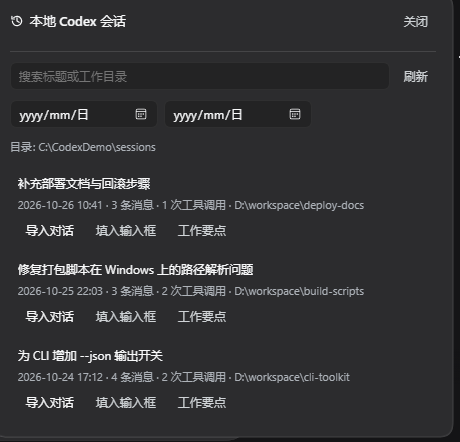
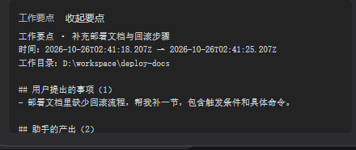

# dsh-codex-history

> 让 DeepSeek Harness（DSH）与本地 Codex CLI 的聊天记录**无缝衔接**。
> 插件会自动读取 `~/.codex/sessions` 里的 Codex 会话记录，把它交给 DSH 的模型继续干活；
> 当 Codex 那边有了新进展，会自动同步回当前对话。

[](https://github.com/chameleonn4/dsh-codex-history)
[](./LICENSE)
[](https://nodejs.org)
[](https://github.com/awesome-dsh-plugin/awesome-dsh-plugin/pull/9052)

English README: [README.en.md](./README.en.md)

> 📌 **上架状态**：已向 [awesome-dsh-plugin](https://github.com/awesome-dsh-plugin/awesome-dsh-plugin)（DSH 插件市场的精选列表）提交收录 PR
> [#9052](https://github.com/awesome-dsh-plugin/awesome-dsh-plugin/pull/9052)。仓库创建满 1 天后该检查会自动转绿并合入，
> 之后就能在 [awesome-dsh-plugin.com](https://awesome-dsh-plugin.com) 和 dsh-market 里搜到本插件。



---

## 1. 它解决什么问题

你在 Codex CLI（或 Codex Desktop）里聊了一上午，积累了一批对话；换到 DSH 时，这些上下文**不会自动跟过来**。
`dsh-codex-history` 把 Codex 的本地会话记录变成 DSH 的一等公民：

| 能力 | 说明 |
| --- | --- |
| **自动读取** | 后台轮询 `~/.codex/sessions/**/rollout-*.jsonl`，文件一有变化就重新索引（默认 5 秒），不需要手动刷新 |
| **模型可用** | 注册 `codex_history` 工具：模型可以自己列出、检索、读取历史会话，不会凭空猜测 Codex 里聊过什么 |
| **用户可用** | 注册 `/codex` 斜杠命令，以及 Web 面板里输入框下方的 **「Codex 历史」** 入口 |
| **一键交接** | 把某个 Codex 会话整段导入当前 DSH 对话继续工作，或把内容填进输入框 |
| **自动带入** | 新建会话时，若当前工作目录在 Codex 里聊过，自动把那次会话作为上下文带进来 |
| **实时回灌** | 导入过的会话在 Codex 侧出现新消息时，增量同步回同一个 DSH 对话（不会自己触发一轮回答） |
| **工作要点** | `worklog` 动作把长会话压缩成「用户要什么 / 助手做了什么 / 跑了哪些命令 / 动了哪些文件 / 哪里失败了」 |
| **跨机共享** | 可选的共享目录：台式机与工位笔记本用 Syncthing / OneDrive / 网盘同步同一份目录，两边互相能看到对方的 Codex 与 DSH 会话 |

插件**零运行时依赖**（只用 Node 内置模块），**只读** `~/.codex`，不会改写 Codex 的任何文件。

---

## 2. 界面

Web 端在**输入框下方**多出一枚与其他下栏完全同款的小胶囊按钮「**Codex 历史**」（与 `activity`、`usage` 同字号、同色系）。


点击后弹出面板：


```
本地 Codex 会话                                    关闭
[ 搜索标题或工作目录            ] [刷新]
[ 起始日期 ] [ 截止日期 ]
目录: C:\Users\you\.codex\sessions

昨天写的周报脚本 · D:\work\report
2026-10-23 00:22 · 21 条消息 · 3 次工具调用 · D:\skills
[导入对话] [填入输入框] [工作要点]
```

- **导入对话**：把整段会话作为上下文注入当前 DSH 对话，模型接着往下做。
- **填入输入框**：把会话内容写进输入框，你自己决定怎么问。
- **工作要点**：展开结构化摘要（做了什么、动了哪些文件、哪里失败）。



> 面板里的会话来自本机 Codex 目录；开启共享目录后，其他机器的会话也会出现在同一列表里，并标注来源机器。
> 截图使用演示数据，不含任何真实会话内容。

---

## 3. 环境要求与版本兼容

| 项目 | 要求 |
| --- | --- |
| DSH | **≥ 0.2.0**（本插件在 **0.2.1-rc.2** 上开发并验证；`package.json` 里声明 `engines.dsh: ">=0.2.0"`） |
| 运行时 | Node.js ≥ 20（随 DSH 桌面版一起分发，无需另装） |
| 操作系统 | Windows / macOS / Linux（路径全部走 `path` API，跨平台） |
| 依赖 | **零运行时依赖**，只用 Node 内置模块 |
| Codex | 需要 Codex CLI / Codex Desktop 写过会话，即 `~/.codex/sessions` 下有 `rollout-*.jsonl` |

> DSH 版本低于 `0.2.0` 时，插件管理器会以 `incompatible-version` 拒绝安装，并给出 `engines.dsh` 未满足的记录。

---

## 4. 安装

只有三种装法，任选其一。

### 4.1 方式一：AI 部署（推荐）

**打开 DSH，直接跟它说一句话就行。** 把下面这句原样发给 DSH 里的 agent：

```
帮我安装 dsh-codex-history 插件，地址是 github:chameleonn4/dsh-codex-history
```

agent 会自己完成整套流程：

1. 调用插件管理器的 `install_bundle`，先 `git ls-remote` 确认仓库可达；
2. 执行 `pnpm add`，把插件作为 bundle 装进当前 profile，并自动写入 `cordis.patch.yml` 的插入行；
3. 校验 `engines.dsh`（本插件要求 DSH ≥ 0.2.0），不满足会回滚并说明原因；
4. 提示你重启 DSH。

重启后输入框下方就出现「**Codex 历史**」。

想连配置一起让 agent 写好，就把需求一起说，例如：

```
帮我安装 dsh-codex-history 插件（github:chameleonn4/dsh-codex-history），
并把 sessionsDir 设成 C:\Users\me\.codex\sessions，
同时打开跨机共享目录，目录用 D:\CodexShare。
```

> agent 的安装动作需要 `danger-full-access` 权限；在受限权限下它会提示你授权，或改用方式三手动安装。

### 4.2 方式二：插件市场（dsh-market）

1. 打开 **dsh-market** 插件市场；
2. 搜索 `dsh-codex-history`（或「Codex 历史」「Codex」）；
3. 点安装，按提示重启 DSH。

市场里的插件列表来自精选列表 [awesome-dsh-plugin](https://github.com/awesome-dsh-plugin/awesome-dsh-plugin)，
本插件的收录 PR 是 [#9052](https://github.com/awesome-dsh-plugin/awesome-dsh-plugin/pull/9052)；
合并后就会出现在市场里。国内网络下市场会自动切换到 npm 镜像。

> 收录合并前，先用方式一或方式三装。

### 4.3 方式三：插件管理器

1. 打开 DSH → **插件** 页面（侧边栏的插件管理页）→ 添加插件；
2. 填入安装地址，三种写法任选其一：

   ```
   github:chameleonn4/dsh-codex-history
   https://github.com/chameleonn4/dsh-codex-history.git
   chameleonn4/dsh-codex-history
   ```

3. 确认安装。插件管理器会执行 `git ls-remote` + `pnpm add`，把插件作为 bundle 装进当前 profile，
   并自动写入 `cordis.patch.yml` 的插入行；
4. **重启 DSH**，输入框下方就会出现「Codex 历史」。

> 从 GitHub 安装时，版本兼容性（`engines.dsh`）在拉取之后校验；不满足时会回滚 profile 清单，
> 并给出 `incompatible-version` 记录（本插件要求 DSH ≥ 0.2.0）。

### 4.4 工位笔记本部署清单

在一台**新机器**上装好这套插件，只要按下面的顺序走一遍：

| # | 步骤 | 说明 |
| --- | --- | --- |
| 1 | 确认 DSH 版本 ≥ 0.2.0 | 插件页 → 关于 / `dsh --version` |
| 2 | 在这台机器上正常使用 Codex 一次 | 需要 `~/.codex/sessions` 下有 `rollout-*.jsonl`，否则没有历史可读 |
| 3 | 让 DSH 装它：说一句「帮我安装 dsh-codex-history 插件」 | 见 4.1；也可以走市场或插件管理器 |
| 4 | 重启 DSH | 输入框下方出现「Codex 历史」即安装成功 |
| 5 | （可选）配置 `~/.dsh/profiles/<profile>/cordis.patch.yml` | 见第 5 节；不配就用默认值 |
| 6 | （可选）两台机器共享同一份被同步的目录 | 见第 7 节，配置 `share.enabled: true` |
| 7 | 验证 | 打开面板应能看到本机 Codex 会话；或 `GET /api/codex-history/status` 返回 `sessionCount > 0` |

> 换机器时**不需要**迁移任何配置或数据：会话记录留在各自的 `~/.codex/sessions`，
> 插件只读。想让两台机器互相看到对方的会话，用第 7 节的共享目录方案。

---

## 5. 配置

### 5.1 写在哪儿

插件配置来自 profile 的 patch 层：**`~/.dsh/profiles/<profile>/cordis.patch.yml`**。
用补丁行的 `id` 指向插件（`id: codex-history`）即可覆盖配置。

> ⚠️ `config` 是**整体替换**而不是深度合并，请把要保留的字段一起写上。

```yaml
# ~/.dsh/profiles/desktop/cordis.patch.yml
- id: codex-history
  config:
    sessionsDir: 'C:\Users\you\.codex\sessions'
    indexPath: 'C:\Users\you\.codex\session_index.jsonl'
    pollIntervalMs: 5000
    maxListResults: 50
    maxTranscriptChars: 20000
    maxImportChars: 12000
    autoImport:
      enabled: true
      matchCwd: true
      maxChars: 6000
      maxMessages: 40
    liveSync:
      enabled: true
      maxChars: 6000
    share:
      enabled: false
      dir: 'C:\Users\you\CodexShare'
      machineId: 'desktop'
      label: '台式机'
      mirrorCodex: true
      mirrorDsh: true
      intervalMs: 30000
      discoverIntervalMs: 15000
```

改完保存后重启 DSH（或重新启用该插件）即可生效。

### 5.2 配置项

| 键 | 默认值 | 说明 |
| --- | --- | --- |
| `sessionsDir` | `~/.codex/sessions` | Codex 会话目录 |
| `indexPath` | `~/.codex/session_index.jsonl` | Codex 会话标题索引 |
| `pollIntervalMs` | `5000` | 目录轮询间隔（毫秒），决定「自动读取」的延迟 |
| `maxListResults` | `50` | 列表类接口最多返回多少条 |
| `maxTranscriptChars` | `20000` | 单次读取的转录长度上限（字符） |
| `maxImportChars` | `12000` | 导入当前对话的上下文字符上限 |
| `autoImport.enabled` | `true` | 新会话是否自动带入同目录的 Codex 上下文 |
| `autoImport.matchCwd` | `true` | 自动带入时是否按工作目录匹配 |
| `autoImport.maxChars` | `6000` | 自动带入的字符上限 |
| `autoImport.maxMessages` | `40` | 自动带入的最大消息条数（取最近 N 条） |
| `liveSync.enabled` | `true` | 是否把 Codex 侧的新消息增量同步回已导入的对话 |
| `liveSync.maxChars` | `6000` | 单次增量同步的字符上限 |
| `share.enabled` | `false` | 是否启用跨机共享目录 |
| `share.dir` | `~/CodexShare` | 共享目录（两台机器指向同一份同步目录即可） |
| `share.machineId` | 主机名 | 本机标识（用于隔离各机器写入的子目录） |
| `share.label` | 同 `machineId` | 展示用的机器名（列表里显示「来源机器」） |
| `share.mirrorCodex` | `true` | 是否把本机 Codex 记录写进共享目录 |
| `share.mirrorDsh` | `true` | 是否把本机 DSH 会话日志写进共享目录 |
| `share.intervalMs` | `30000` | 镜像写入间隔 |
| `share.discoverIntervalMs` | `15000` | 发现其他机器目录的间隔 |

---

## 6. 使用

### 6.1 模型工具：`codex_history`

模型在需要时自动调用，也可以由你直接要求：「看看我之前在 Codex 里改的那个周报脚本」。

| 动作 | 参数 | 说明 |
| --- | --- | --- |
| `list` | `limit`, `since`, `until` | 列出最近的 Codex 会话 |
| `read` | `session_id` | 读取某个会话的完整转录 |
| `search` | `query`, `limit` | 全文检索所有消息 |
| `latest` | `cwd`, `since`, `until` | 找到某个工作目录最近的那次会话 |
| `worklog` | `session_id` 或 `cwd` + `since`/`until` | 生成工作要点摘要 |

时间参数 `since` / `until` 支持 `YYYY-MM-DD` 或 ISO 8601 时间；只写日期时按**整天（UTC）**处理。
会话按「区间重叠」筛选——会话开始于区间之前但区间内仍在更新，也会被算进来。

### 6.2 模型工具：`dsh_history`

开启共享目录后可用，用来读**其他机器**的 DSH 对话：`list` / `read` / `search`。

### 6.3 斜杠命令

```
/codex                          列出最近的 Codex 会话
/codex list                     同上
/codex search <关键词>          全文检索
/codex worklog [起始] [结束]    时间窗口内的工作要点
/codex <会话 id> [消息条数]     把该会话导入当前对话
/dsh                            列出其他机器共享过来的 DSH 会话
/dsh search <关键词>            检索那些会话
```

### 6.4 Web 面板

输入框下方的「Codex 历史」→ 搜索 / 按日期过滤 / 导入对话 / 填入输入框 / 查看工作要点。

### 6.5 自动带入与实时回灌

- **自动带入**：新建 DSH 会话时，若当前工作目录在 Codex 里有记录，插件会把最近那次会话作为上下文注入。
  （只对根会话生效，子代理不会被重复注入。）
- **实时回灌**：某个 Codex 会话已被导入到某个 DSH 会话后，Codex 侧新增的消息会以「增量」形式注入同一个对话。
  注入用的是 *inject*（排进下一次 step），**不会自己触发一轮模型回答**。

---

## 7. 跨机共享目录（台式机 ↔ 工位笔记本）

给两台机器准备一个会被同步的目录（Syncthing、OneDrive、坚果云、网盘都行），两边都指向同一个路径，然后：

```yaml
- id: codex-history
  config:
    share:
      enabled: true
      dir: 'D:\CodexShare'      # 两台机器指向同一个被同步的目录
      machineId: 'desktop'       # 这台改成 'laptop'
      label: '台式机'            # 这台改成 '笔记本'
```

目录结构（每台机器只写自己的子树，所以同步工具永远不需要合并两个写入方）：

```
<共享目录>/
  machines/<machineId>.json        机器描述（名称、主机名、系统）
  codex/<machineId>/sessions/…     该机器的 Codex 会话文件
  codex/<machineId>/session_index.jsonl
  dsh/<machineId>/sessions/…       该机器的 DSH 会话日志
```

开启后：

- 列表里会同时出现本机和**其他机器**的 Codex 会话，并标注来源；
- `/dsh` 与 `dsh_history` 工具可以读其他机器的 DSH 对话。

---

## 8. HTTP API

所有接口挂在 `/api/codex-history` 下，并复用 DSH 自带的登录 / 同源校验（未登录返回 `401`，跨站或不可信请求返回 `403`）。

| 方法 | 路径 | 说明 |
| --- | --- | --- |
| `GET` | `/api/codex-history/status` | 插件状态、版本、目录、会话数、共享目录概况 |
| `GET` | `/api/codex-history/sessions` | 会话列表，支持 `query` / `cwd` / `since` / `until` / `limit` |
| `GET` | `/api/codex-history/session?id=` | 单个会话的完整转录 |
| `GET` | `/api/codex-history/worklog` | 工作要点，支持 `id` / `cwd` / `since` / `until` / `limit` |
| `POST` | `/api/codex-history/import` | 导入会话：`{"id": "<会话 id>", "targetSessionId": "<DSH 会话 id>"}` |
| `GET` | `/api/codex-history/dsh-sessions` | 其他机器共享来的 DSH 会话列表 |
| `GET` | `/api/codex-history/dsh-session?id=` | 其他机器的 DSH 会话转录 |

---

## 9. Codex 会话记录是怎么被解析的

Codex 把每次对话写成一个 JSONL 文件：

```
~/.codex/sessions/2026/10/22/rollout-2026-10-22T23-12-43-<uuid>.jsonl
```

每行是一条 `{"timestamp":…,"type":…,"payload":…}` 记录，插件主要用到的类型：

| 记录 | 用途 |
| --- | --- |
| `session_meta` | 会话 id、工作目录、CLI 版本、模型提供方 |
| `response_item` / `message` | 用户与助手的正文（`role` 为 `user` / `assistant`） |
| `event_msg` / `item_completed` | 补充消息（`UserMessage` / `AgentMessage`） |
| `event_msg` / `task_complete` | 最后一轮回答（兜底） |
| `response_item` / `custom_tool_call`、`function_call` | 工具调用与命令，用来生成工作要点 |
| `turn_context` | 每轮的模型与沙箱设置 |

清洗规则（把 Codex 的内部包装还原成人话）：

- 丢弃每轮开头的 `<environment_context>` 块（cwd、shell、日期等环境信息）；
- `<send_user_message_question_reply>` 展开成「问 / 答」列表；
- `# Files mentioned by the user:` + `## My request:` 拆成「提到的文件」和「请求」；
- `# Response annotations:` 展开成批注列表；
- 去掉 `:codex-annotation{index="N"}` 这类界面标记。

会话标题取自 `~/.codex/session_index.jsonl`（`thread_name`），取不到时退回首条用户消息的摘要。

DSH 侧的会话日志是 `session.v4.jsonl.zstd`（多帧 zstd 容器），插件会自己定位帧边界再逐帧解压，因此跨机共享时也能读出对方的 DSH 对话。

---

## 10. 源码结构

```
dsh-codex-history/
├── index.js                 Host 侧入口：注册工具、命令、HTTP 路由、后台同步
├── lib/
│   ├── parse.js             Codex rollout JSONL 解析与清洗
│   ├── store.js             会话索引、时间窗口、增量刷新
│   ├── format.js            转录 / 导入 / 增量 / 工作要点的文本渲染
│   ├── share.js             跨机共享目录：镜像、发现、机器描述
│   ├── dshstore.js          共享目录里其他机器的 DSH 会话索引
│   └── dshlog.js            DSH 会话日志（多帧 zstd）解码
├── client/
│   └── client.js            Web 端面板（React，走 conversation.composer.dock 插槽）
├── locale/
│   ├── zh.json              插件管理器里显示的名称与描述
│   └── en.json
├── cordis.patch.yml         bundle 补丁：把插件插入组合
├── icon.svg
├── test/                    自测脚本（见下）
└── tools/asar.js            开发辅助：读取 app.asar（仅开发用）
```

---

## 11. 开发与测试

### 11.1 从源码开发

```bash
git clone https://github.com/chameleonn4/dsh-codex-history.git
cd dsh-codex-history
```

在 profile 目录下执行 `pnpm add link:D:/path/to/dsh-codex-history` 建立链接后，
改完代码在插件管理器里重新启用一次 `codex-history`（或 `dsh plugin ... set_plugin include:codex-history enabled=true`），
Host 侧代码会热重载；Client 侧刷新一次页面即可。

### 11.2 测试

```bash
# 语法检查
node --check index.js && node --check client/client.js

# 解析器与工作要点的断言
node test/parse-check.mjs

# 用假 ctx 跑通 Host 侧：工具、命令、路由、agent/created 钩子
node test/plugin-mock.mjs

# 端到端增量同步：写一个临时 rollout → 触发自动导入 → 追加消息 → 验证增量注入
node test/live-sync.mjs

# 直接解析真实的 ~/.codex/sessions，输出转录与工作要点
node test/host-smoke.mjs

# 跨机共享全链路自测：造两台假机器，验证镜像、发现、读取与检索
node test/share-check.mjs

# 对着运行中的 DSH 打一次真实 HTTP 请求（需要登录态）
node test/http-check.mjs
```

`test/` 里的脚本不依赖 DSH 运行时（只有 `http-check.mjs` 需要一个正在运行的实例与登录 Cookie），可以直接在 CI 上跑。

---

## 12. 常见问题

**Q：面板里什么都没有？**
A：确认 `~/.codex/sessions` 下确实有 `rollout-*.jsonl`（用 Codex CLI 聊过一次即可）。
也可以打开 `GET /api/codex-history/status` 看 `available` 与 `sessionCount`。

**Q：模型好像不知道 Codex 里聊过什么？**
A：模型需要主动调用 `codex_history` 工具。插件已经在系统提示里告诉它这个工具的存在；
你也可以直接说「用 codex_history 搜一下 …」。

**Q：自动带入没有触发？**
A：自动带入要求 (1) `autoImport.enabled` 为真；(2) 会话是根会话；(3) Codex 会话的 `cwd` 与当前会话工作目录一致。

**Q：改动代码后 Host 没生效？**
A：链接安装（`link:`）的情况下，改完文件需要在插件管理器里重新启用一次插件，Host 侧才会热重载。

**Q：Windows 上路径反斜杠要注意什么？**
A：`sessionsDir`、`share.dir` 等路径建议写成 `'C:\Users\you\.codex\sessions'`（YAML 单引号里反斜杠无需转义）。

---

## 13. License

[MIT](./LICENSE) © chameleonn4
